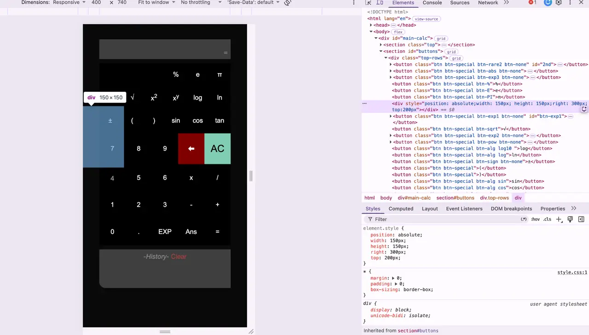
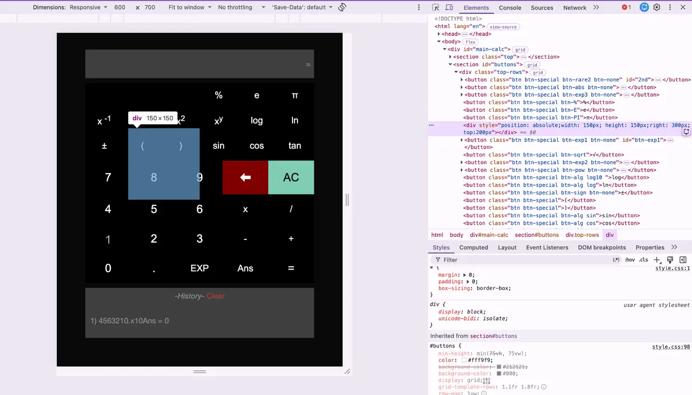
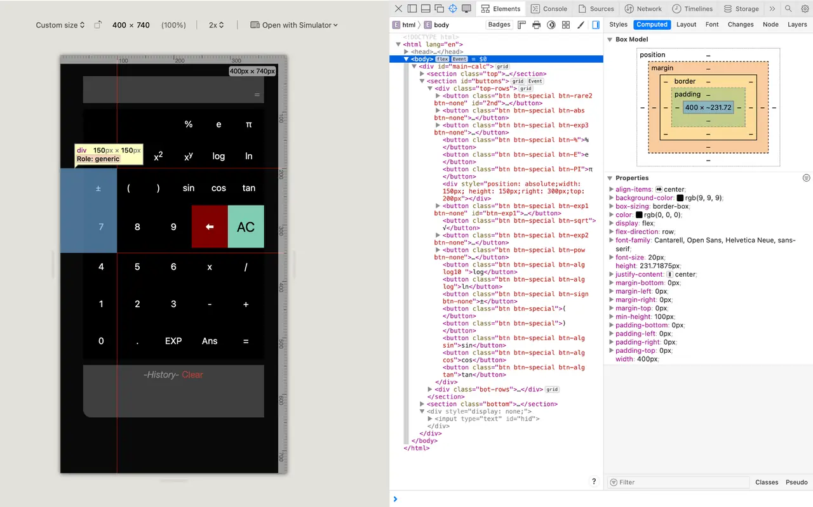

# Bug Report 01 — Calculator Buttons Unresponsive at Specific Viewport Sizes

**Project:** Scientific Calculator (`index.html`)  
**Testing type:** Manual functional and responsive UI testing  
**Browser:** Google Chrome (version not recorded)  
**Viewport sizes:** 400 × 740 px; 600 × 700 px  
**Status:** Defect observed during manual testing; fix verification not documented

## Description

At a viewport of **400 × 740 px**, calculator button **7** does not respond to clicks. At **600 × 700 px**, button **8** does not respond.

## Steps to Reproduce

1. Open the calculator in Google Chrome.
2. Resize the browser viewport to **400 × 740 px**.
3. Click button **7**.
4. Resize the browser viewport to **600 × 700 px**.
5. Click button **8**.

## Expected Result

Both buttons should respond to clicks and display their corresponding numbers.

## Actual Result

- At **400 × 740 px**, button **7** does not respond.
- At **600 × 700 px**, button **8** does not respond.

## DevTools Investigation

Using Chrome DevTools, an invisible **150 × 150 px** `div` was found overlapping the affected button area.

Observed CSS properties:

```css
position: absolute;
width: 150px;
height: 150px;
right: 300px;
top: 200px;
```

This is an investigation finding, not confirmation that a code fix has been applied.

## Evidence

The following screenshots were extracted from the original Word report and are included in this repository.

**1. Button 7 not responding — 400 × 740 px (Chrome DevTools)**



**2. Button 8 not responding — 600 × 700 px (Chrome DevTools)**



**3. Additional element inspection — Safari Web Inspector**



The Safari screenshot documents inspection of the same element; it does **not** establish that the click bug was reproduced in Safari.

[Original formatted report in Google Docs](https://docs.google.com/document/d/1i3UwSWO1wzxU2BAVB_SXlv9zy6Xyc5AwtYLsj9Mbi1Q/edit)

## Scope and Limitations

- The reported nonresponsive buttons were observed in **Google Chrome**.
- A browser version was not recorded.
- Safari was used during investigation, but whether the bug reproduced there was not documented.
- No retest after a fix is claimed.

---

*Based on an existing manual QA assignment and revised to reflect instructor feedback: concise defect description, reproduction from the user's perspective, and separate DevTools findings.*
